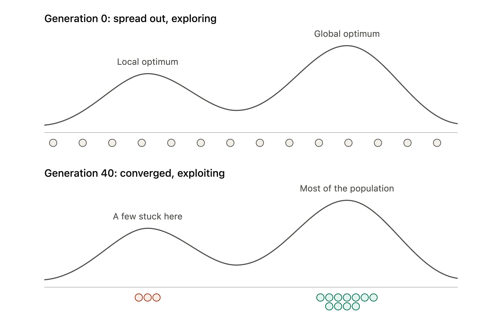

# Genetic Algorithms Journal

- **Student Names:** [James Kelly] [Andrew Jaffray]
- **Student ID:** [23370858] [23382163]

# Week 1 — 6/11/26

Designed and implemented a genetic algorithm for OneMax. Got familiar with the main ideas: fitness, selection, crossover and mutation etc. We also began talking about some possible ideas for the project and how it might be structured

Genetic Algorithms:

The picture above is the mental model to hold on to. Think of every possible solution as a point on a landscape, where height is fitness. At the start, the population is scattered all over it. Over the generations, selection pulls individuals uphill. Crossover and mutation keep sending out “probes” to nearby and in-between points. The population behaves like a swarm feeling its way up the landscape.

## Differences between GA and GP

- Representation: GA uses a string, GP uses a tree.
- Crossover: GA swaps parts of strings, GP swaps subtrees.
- Mutation: GA changes parts of a string, GP changes parts of a tree.
- Fitness: GA scores a string GP runs a tree as a program and scores its output.

- Used Graphviz for visualising the tree to see the terminals and operators

## Testing our GP
- Our GP did quite well with the first set of data, achieving perfect fitness within 3 generations. However it never achieved perfect fitness for second set of data. We tried changing the numerous variables such as generation, population etc. to achieve a lower MAE but it still wasn't enough to get to the correct formula fully.

## Project Comparison: Flappy Bird vs Pac-Man
## Overview

| | Flappy Bird | Pac-Man |
|---|---|---|
| What GP evolves | Flap or not (one output) | 1 of 4 directions |
| Primitive set | Small, all numeric (`dy`, `velocity`, `dx`, gap edges, constants) | Larger (distances to pills, power pills, ghosts, edible ghosts, pills left, constants) |
| Functions | `+ − ×`, protected `/`, `if_less_than`, `max`, `min` | Same, plus more conditionals |
| Fitness | Frames survived + bonus per pipe, averaged over 3–5 seeds | Game score (+ survival bonus), averaged over 3–5 games |
| Typical evolved solution | Small feedback rule, e.g. `(dy + velocity × 2) − 5` | Larger trees balancing pill collection and ghost avoidance |

## Ways to extend

| Flappy Bird | Pac-Man |
|---|---|
| Harder variants: narrower gaps, moving pipes, increasing speed | Test on unseen mazes |
| Generalisation: train easy, test hard | Co-evolve ghosts as a second population |
| GP vs GE on the same controller | GP vs GE on the same controller |

